# Electromagnetics Study Patch

Jupyter notebooks, a small tested Python library and Manim animations for learning classical
electromagnetism by computing it. The work follows the UiO course FYS1120 and its textbook,
Malthe-Sørenssen, *Elementary Electromagnetism Using Python* (2026). The book is reference only.
It is not in this repo, and no code or exercise solutions from it appear here. Every notebook
points to the chapter and sections it pairs with.

<p align="center">
  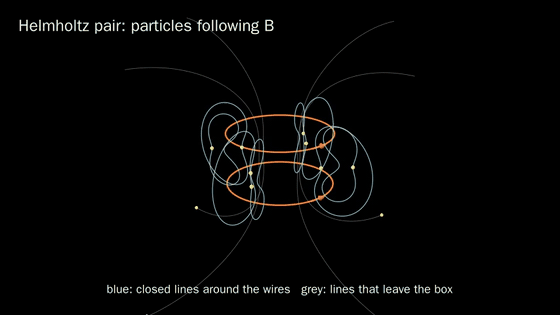
</p>

## What is here

The course is split into six modules. Each module groups related chapters by physics, not by the
book's table of contents.

| Module | Book chapters | Primers | Notebooks | Status |
|---|---|---|---|---|
| M1 Fields, superposition, potential | 1, 2, 3 | 5 | 3 | done |
| M2 Electrostatics: Gauss, Laplace, conductors, capacitance | 4, 6, 7, 8 | 3 | 4 | done |
| M3 Dielectrics and bound charge | 5 | 1 | 2 | done |
| M4 Magnetostatics | 11, 12, 13 | 3 | 4 | done |
| M5 Circuits and disordered media | 9, 10, 16 | 4 | 4 | done |
| M6 Induction, Maxwell, waves | 14, 15, 17 | 4 | 4 | done |

All six modules are finished: 20 primers, 21 main notebooks, 28 animated scenes and 80 library tests. [PLAN.md](PLAN.md) has the full roadmap.

## How a module is organised

- **Primers** (`00a`, `00b`, ...) teach the content of the chapters in full. Each primer has a prose
  account of the ideas, a series of hand-worked examples, code that reproduces every hand result, an
  exercise, a closed-form check, a key-results sheet and answers to its warm-up questions. A reader
  who works through the primers can follow the main notebooks without the book.
- **Main notebooks** (`01`, `02`, ...) turn each law into an algorithm and test it. They follow one
  five-part template: recall prompts, principle to algorithm, build with an exercise, verify against
  a closed form, and explore and rebuild from memory.
- **Animations** show the ideas where change is the point, such as a sum converging, charges moving
  to equilibrium, or contributions cancelling. Rendered scenes play inside the notebooks.
- **`emlib`** is the shared library the notebooks call. Every function is tested against a
  closed-form result.
- **`study/`** holds one blank-sheet recall sheet per module and a spaced-retrieval schedule.

## Animations

A selection of the 28 scenes. Each one is embedded in the primer or notebook that teaches its idea.

<table>
<tr>
<td width="33%">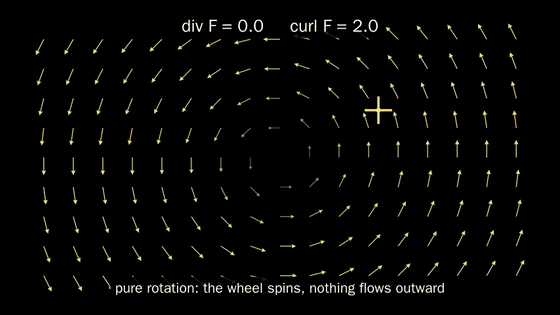<br><b>Divergence and curl.</b> A field morphs from rotation to expansion. The paddlewheel spins only while the curl is non-zero. (M1)</td>
<td width="33%">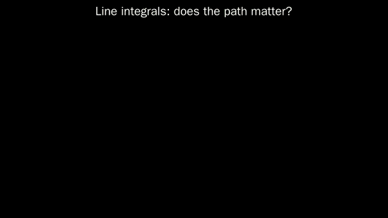<br><b>Path independence.</b> Two paths, two fields. One field gives the same work on both paths and the other does not. (M1 primer 00b)</td>
<td width="33%">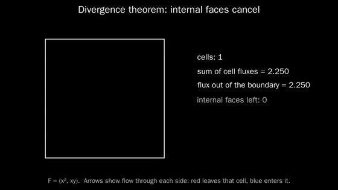<br><b>Why the divergence theorem holds.</b> Flux through every internal face cancels in pairs, leaving only the boundary. (M1 primer 00d)</td>
</tr>
<tr>
<td>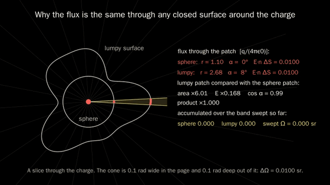<br><b>Gauss' law from geometry.</b> A cone from the charge carries the same flux through a sphere and through a lumpy surface. (M2 primer 00a)</td>
<td>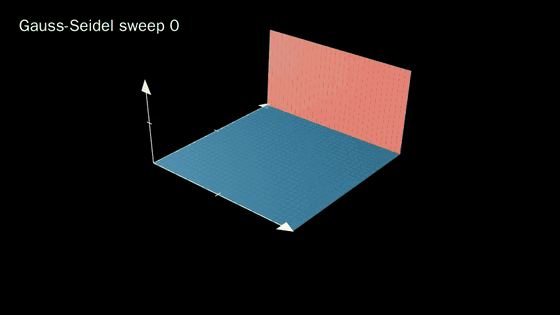<br><b>Relaxation.</b> The potential surface settles sweep by sweep as information spreads in from the 1 V edge. (M2)</td>
<td>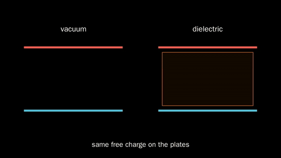<br><b>Dielectrics.</b> Molecules align, bound charge forms on the slab faces and the field inside drops to E0/εr. (M3)</td>
</tr>
<tr>
<td>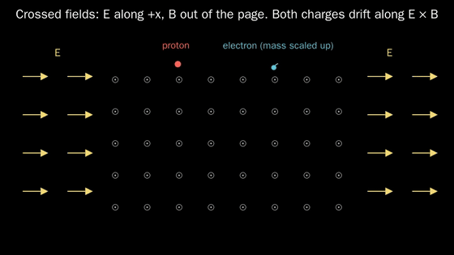<br><b>E × B drift.</b> A proton and an electron start at rest and drift the same way at E/B. (M4 primer 00a)</td>
<td><br><b>Ampere's law.</b> The circulation stays at μ0I for any loop shape around the wire. (M4 primer 00b)</td>
<td><br><b>Helmholtz pair.</b> Particles trace the closed field lines of two coaxial coils. (M4)</td>
</tr>
</table>

## From the notebooks

Every figure below is computed in a notebook, and each comes with a check against a closed form.

<table>
<tr>
<td width="33%">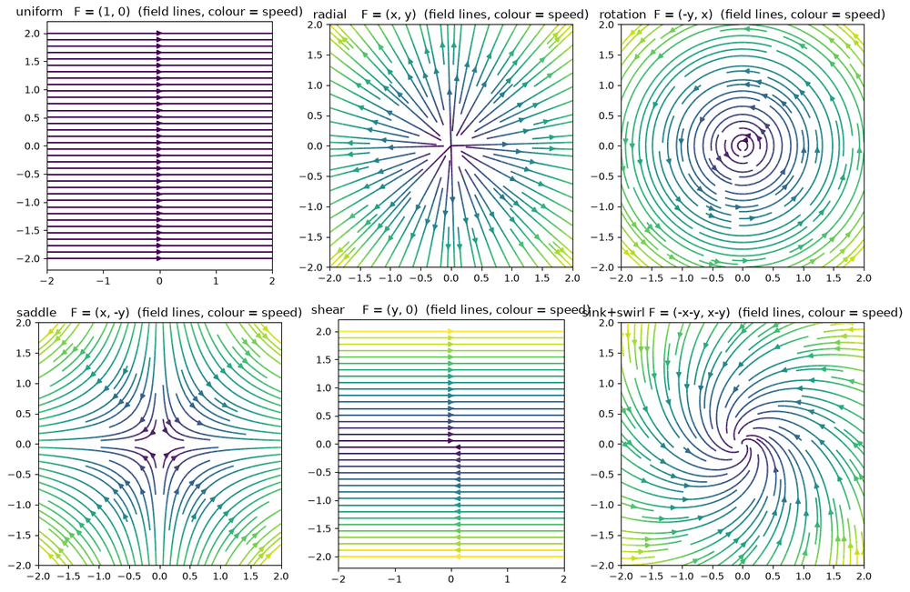<br>Six reference fields used to build intuition for divergence and curl. (M1 primer 00a)</td>
<td width="33%">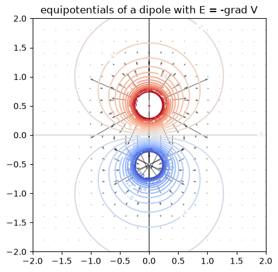<br>Equipotentials of a dipole with E = −∇V, field always perpendicular to them. (M1.3)</td>
<td width="33%">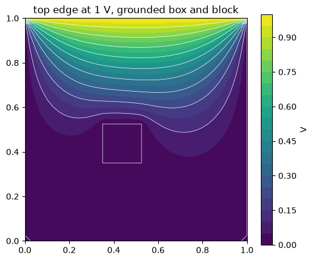<br>Laplace's equation with a 1 V edge and a grounded block, by sparse direct solve. (M2 primer 00b)</td>
</tr>
<tr>
<td>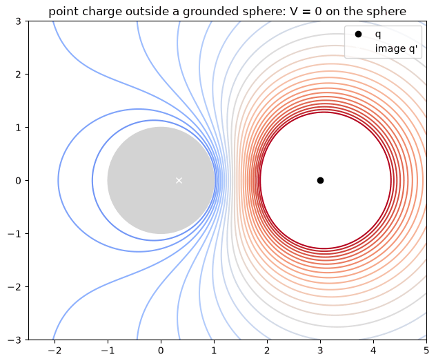<br>A point charge outside a grounded sphere and its image charge: V = 0 on the sphere. (M2 primer 00c)</td>
<td>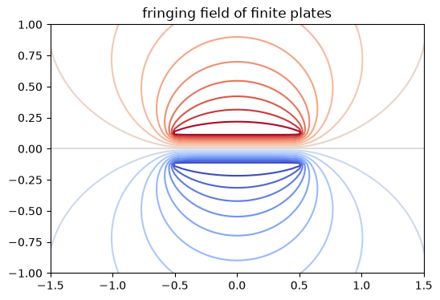<br>Fringing field of finite capacitor plates, with capacitance from field energy. (M2.4)</td>
<td>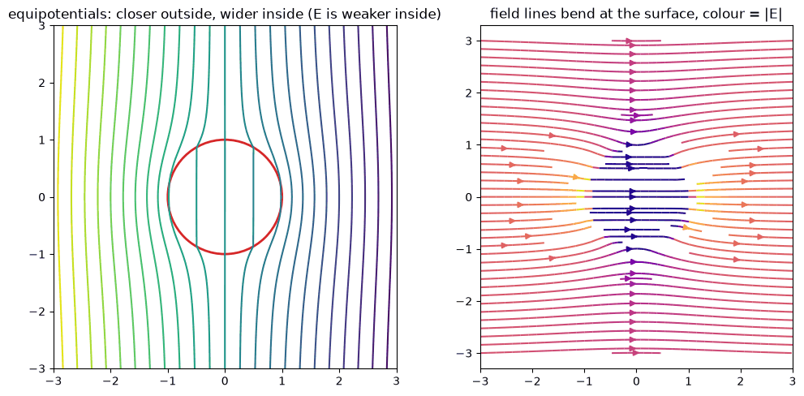<br>A dielectric cylinder in a uniform field: field lines bend at the surface, interior field uniform. (M3 primer 00a)</td>
</tr>
<tr>
<td>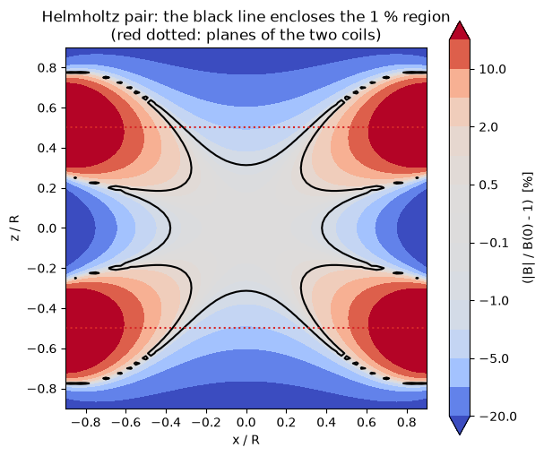<br>Percentage deviation from the centre field inside a Helmholtz pair. (M4.1)</td>
<td>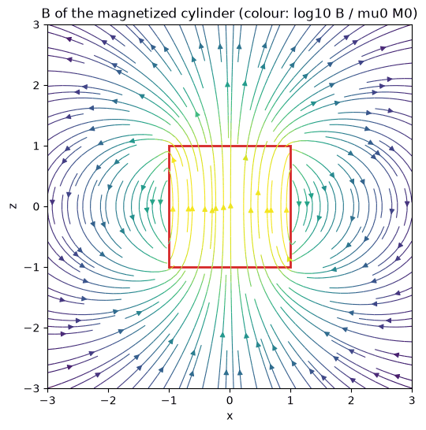<br>A magnetized cylinder computed from its bound surface current: a bar magnet. (M4.4)</td>
<td>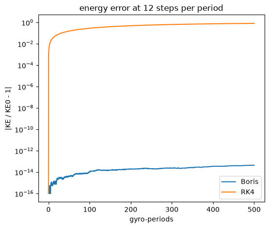<br>Energy error over 500 gyro-periods: the Boris pusher stays at round-off while RK4 drifts. (M4.3)</td>
</tr>
</table>

## Setup

Requires [`uv`](https://docs.astral.sh/uv/), `ffmpeg`, and the Cairo and Pango development
libraries for Manim. The project is pinned to Python 3.12 because Numba and Manim have no 3.14 wheels.

```
uv sync
```

## Run

```
uv run jupyter lab                      # open the notebooks
uv run pytest                           # run the emlib tests
uv run python -m emlib.show            # render every scene at 1080p (skips ones already rendered)
uv run manim -qh --media_dir media/<module> animations/<module>/scenes.py <SceneName>   # render one scene
```

Scenes render at 1080p60. `uv run python -m emlib.show --quality l` renders quick 480p versions,
and notebooks fall back to those when the 1080p video is missing. `--jobs N` renders N modules at once.

Notebooks embed rendered scenes through `emlib.show.animation(module, scene)`. If a scene has not
been rendered, the cell prints its render command. Set `EM_RENDER=1` to render missing scenes on
demand. Rendered videos go to `media/`, which is not tracked.

A suggested path through a module:

1. Work through the primers in order. Answer each warm-up on paper first, then check against the
   answers at the end.
2. Work through the main notebooks in order. Replace each exercise cell with your own code.
3. Fill in the module's recall sheet in `study/recall_sheets/` from a blank page and record the date
   in `study/schedule.md`. Repeat after 24 hours, 7 days and 30 days.

## Repository layout

```
emlib/                 shared library: grids, fields, relax, dielectrics, biot_savart,
                       integrators, magnetization, circuits, percolation, induction,
                       fdtd, show
tests/                 pytest, closed-form checks for every emlib function
notebooks/<module>/    primers (00x) and main notebooks (01, 02, ...)
animations/<module>/   Manim scenes for that module
study/                 recall sheets, retrieval schedule, vector calculus reference
docs/images/           the stills and GIFs used in this README
PLAN.md                roadmap, ground rules and open questions
```

## Ground rules

- The book is reference only. Nothing is copied from it, and the official exercise solutions stay out
  of the repo. Notebooks cite chapters and sections by number.
- Every numerical method is checked against a closed-form case before it is used on a case
  without one.
- Notebooks are committed without outputs, so they run fresh for every reader.
